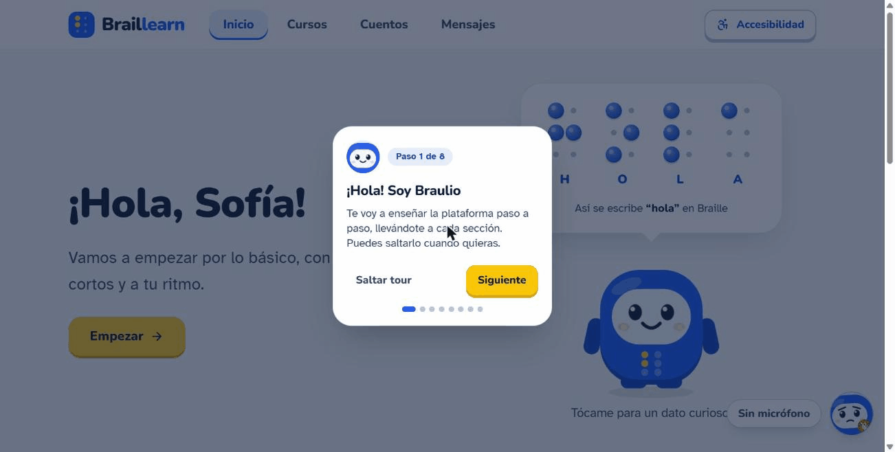
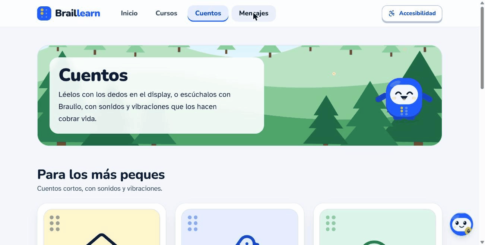
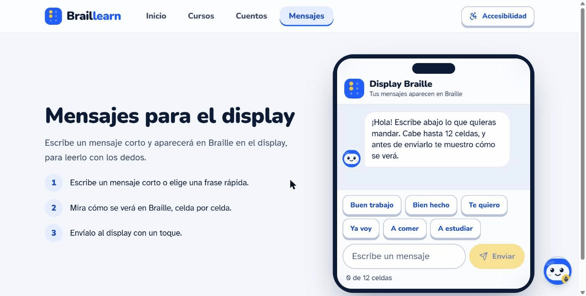
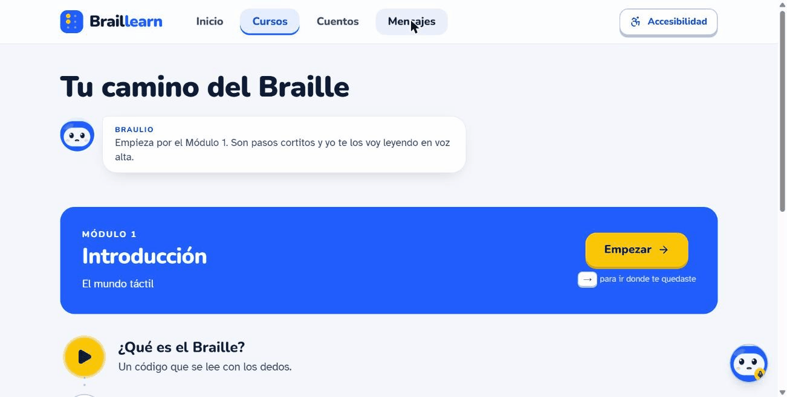
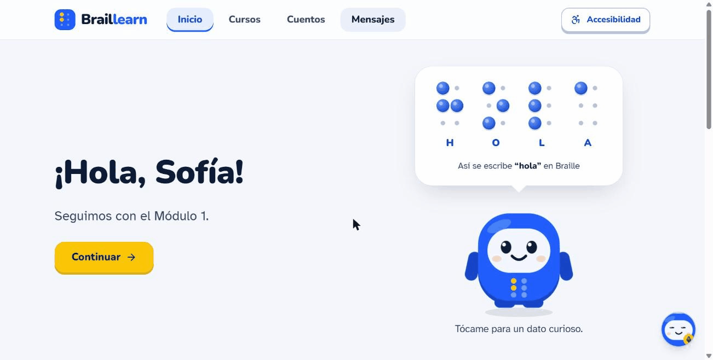

<div align="center">

# Braillearn

**Digital autonomy and Braille literacy for visually impaired learners — web, desktop, and a hardware pilot in the field.**

🥇 **Gold Medal — Infomatrix México National 2026**, advancing to PIST 2026 in Tunisia.
🥈 Silver Medal — Infomatrix 2025 Regional

[](https://react.dev)
[](https://vitejs.dev)
[](https://tailwindcss.com)
[](https://www.electronjs.org)



</div>

---

Braillearn is a comprehensive, multi-channel system designed to break the economic and pedagogical barriers that keep Braille literacy out of reach: a gamified learning platform (web + desktop) paired with a low-cost physical device pilot that brings the same lessons to a tactile Braille cell in a family's home.

This repository holds everything the student and the public see:

- **The learning platform** — the part a student opens every day (web and Electron desktop app).
- **The landing site** — the public presentation of the project, in five languages.
- **The voice assistant backend** — a small local server that powers "Braulio" in the browser.
- **The field provisioning tool** — a standalone CLI for preparing the pilot hardware.

> The platform itself is in Spanish, since that is the language of the learners it was built for. This README is in English.

## See it in action

| | |
|---|---|
| <br>**Stories** — pick a story and listen to it, or read it with your fingers on the display. | <br>**Messages** — a family member writes a short message and sends it to the display. |
| <br>**Lessons** — short, bite-sized steps with a quick check after each chapter. | <br>**Accessibility** — contrast, text size, voice and narration, all in one panel. |

## Key Features

- **Stories** — a library of short stories for young readers (*Los tres cerditos*, *El patito feo*, *La liebre y la tortuga*) and public-domain classics (*Don Quijote*, *Alicia en el País de las Maravillas*). Each story is read in one of two modes:
  - **Listen** — Braulio reads it aloud while the text lights up sentence by sentence.
  - **Touch** — the story is sent to the display one line at a time, and the reader advances at their own pace with their fingers.

  Stories come with sound effects and, on supported hardware, vibration effects. Progress is saved per story. See [Display and haptics](#display-and-haptics).
- **Messages for the display** — a parent or teacher types a short message, previews how it will look cell by cell, and sends it to the physical Braille display. Recent messages can be re-sent with one tap.
- **Guided Courses** — a Duolingo-style path of short, bite-sized steps grouped into chapters: a theory module (what Braille is, who Louis Braille was, how the cell works) with a quick check after each chapter, the vowels, and a set of random challenges with a memory game. Progress is saved per step so you resume exactly where you left off.
- **"Braulio" Voice Assistant** — hands-free control by voice: say the wake word, give a command (go to the courses, the stories or the messages area, open a module or your last lesson, change the accessibility settings) or ask an open question and get a spoken answer. See [Voice assistant](#voice-assistant-braulio).
- **Guided tour** — a narrated walkthrough for first-time users that takes them to each section (progress, courses, stories, messages, accessibility, voice), scrolls to the part it is explaining and highlights it. Fully keyboard-navigable (`←` `→` `Esc`), replayable from the accessibility panel, and respects reduce-motion. While it runs, pages stay quiet so only the tour speaks.
- **Accessibility-First Design** — high-contrast mode, adjustable font scale, text-to-speech, reduce-motion, audio cues and an optional **brief narration** mode (Braulio only says where you are, instead of reading every step), all from one accessibility panel. Not a bolt-on: the target user is the accessibility user.
- **Opt-in usage data** — off by default, stored only on the device, with no names, texts or audio. Useful for studying reading speed and lesson results. See [Usage data](#usage-data).
- **Multilingual Landing Site** — home, technology, history and community pages in Spanish, English, French, Italian and Korean, with interactive 3D models of the display, the Braille cell and the solenoid, and a live (non-navigable) preview of the platform.
- **Cross-Platform** — ships as a web app or a native Windows desktop app via Electron.
- **Field Pilot Tooling** — a standalone provisioning CLI for preparing the Raspberry Pi units deployed to pilot families (see below).

## Tech Stack

| Layer | Technology |
|---|---|
| Frontend | React 19, Vite 7 (multi-page), Tailwind CSS 4 |
| Landing site | Framer Motion, `<model-viewer>` (3D `.glb` models, self-hosted Draco decoder), custom i18n (es, en, fr, it, ko) |
| Audio & Accessibility | Tone.js, Web Speech API, pre-generated sound effects |
| Voice assistant | Porcupine wake word (Whisper via `@xenova/transformers` as local fallback), ElevenLabs voice with Piper TTS as fallback, Claude API |
| Backend for voice | Node.js + Express (`server/`), Electron main process |
| Desktop | Electron + `electron-builder` (Windows installer) |
| Field hardware provisioning | Node.js CLI (`provisioning-tool/`) |

## Site map

The landing is the root of the site and the platform lives on its own path; they don't depend on each other.

| Path | What it is |
|---|---|
| `/` | Landing home — Braillearn and the product |
| `/tecnologia.html` | Technology: hardware, software and backend architecture |
| `/historia.html` | History: the problem, the timeline and how it was built |
| `/comunidad.html` | Community: organizations and resources in Campeche |
| `/platform-demo.html` | Non-navigable preview of the platform, embedded in the home |
| `/plataforma/` | The learning platform (`#/inicio`, `#/cursos`, `#/cuentos`, `#/mensajes`) |

## Getting Started

**Prerequisites:** Node.js 22.

```bash
npm install
npm run dev              # landing — http://localhost:5173 · platform — http://localhost:5173/plataforma/
npm run dev:web          # same, plus the voice API server on :8787 (needed for Braulio in the browser)
npm run electron:dev     # desktop app (Vite dev server + Electron together)
```

**Configuration:** copy `.env.example` to `.env` and fill in the values you need. The landing and the platform run without it; `.env` is only for the voice assistant and is never committed.

| Variable | Used for |
|---|---|
| `ANTHROPIC_API_KEY` | Open-ended questions to Braulio (Claude API) |
| `ELEVENLABS_API_KEY`, `ELEVENLABS_VOICE_ID` | Braulio's natural voice and the story sound effects (optional — falls back to the local Piper voice) |
| `ELEVENLABS_MONTHLY_BUDGET` | Characters per month the server may spend on voice (e.g. `9000`) |
| `TTS_PROVIDER` | Set to `piper` to force the local voice |
| `PICOVOICE_ACCESS_KEY` | Porcupine wake word (optional — falls back to local Whisper) |
| `VOICE_SERVER_PORT` | Port of the voice API server (default `8787`) |
| `VITE_API_URL` | Base URL of the display's API, when you use a real display (see below) |

**Building:**

```bash
npm run build             # production web build -> dist/
npm run preview           # serve the production build locally
npm run electron:build    # packaged Windows installer -> dist-electron/
```

## Voice assistant (Braulio)

Braulio listens for its wake word and then handles a command. Commands the app understands locally (see `src/utils/voiceIntents.js`) run immediately; anything else is sent to Claude, which answers out loud.

- **Wake word:** Porcupine, using a custom `Braulio.ppn` model and your Picovoice AccessKey. Those files are **not** in the repository — see the header of `electron/wakeword/wakeWordService.cjs` for what to generate and where to put it. Without them, Braulio falls back to local Whisper (`Xenova/whisper-base`, downloaded on first use), which needs no account.
- **Speech:** Braulio's voice comes from **ElevenLabs** when `ELEVENLABS_API_KEY` and `ELEVENLABS_VOICE_ID` are set in `.env`. Every generated phrase is cached on disk (`.tts-cache/`), so it is only paid for once, and a monthly character budget (`ELEVENLABS_MONTHLY_BUDGET`) keeps the plan from running out. If ElevenLabs is unreachable or the budget is spent, it falls back to **Piper**, which generates the voice locally (engine and voice are downloaded on first use into `.piper/`; the bundled engine is currently **Windows x64 only**), and then to the browser voice.
  - `npm run tts:audition` renders a sample per candidate voice into `tts-samples/` so you can pick one.
  - `npm run tts:pregenerate` generates and caches every fixed lesson narration ahead of time, so the first visit to a step has no wait.
  - The API key may carry broad permissions, so `electron/tts/elevenlabsService.cjs` only allows the voices list, the credit balance and text-to-speech endpoints. Give the key just those three permissions.
- **Where it runs:** in the Electron app, everything goes through the main process. In the browser, the platform calls the Express server (`npm run server`), which the Vite dev server proxies at `/api` (`/api/ask-claude`, `/api/tts`, `/api/tts/voices`, `/api/health`).
- **Secrets:** the Anthropic key lives only in the server / Electron process, never in the browser bundle.
- **Response time:** open questions use Claude Haiku with streaming, and Braulio starts speaking as soon as the first sentence is ready. `node scripts/bench-voice-latency.cjs` compares that against the first version (Sonnet without streaming, whole answer spoken by Piper). In our measurement (6 runs) the median time from text to first audio went from about 7.4 s to 1.7 s. It does not include the microphone or speech recognition, and 6 runs is a small sample: treat it as indicative.

## Display and haptics

Everything that reads text to the display (stories in touch mode, messages) goes through one place, so the same screens work with a real device or without one.

- **Simulated display** (default) — an on-screen display, so the platform can be tried and developed without hardware. The number of cells is configurable (1–24).
- **Real display** — sign in with the display account in the story settings (or set `VITE_API_URL` / the `braillearn_api_url` entry in `localStorage`). The display reports its own number of cells, and the platform splits each text into lines of that size before sending them.
- **Sound effects** — the stories' sound effects are generated once with ElevenLabs and stored in `src/assets/sfx/`, so nobody needs an API key to run the platform. `npm run sfx:generate -- --dry` lists what is missing and how many seconds it would generate; running it without `--dry` generates only the missing ones. The catalogue lives in `src/data/sfxCatalog.js`.
- **Haptics** — stories ask for vibration effects by name (a knock on the door, wind, rain, footsteps, a magic sparkle, a bell). `src/utils/hapticsService.js` maps each name to a waveform of the **DRV2605L** driver (LRA actuator). The display does not expose a haptics API yet, so that endpoint is a stub (`HAPTICS_ENDPOINT = null`); on phones with a vibration motor the effects play through `navigator.vibrate`, which lets you test the stories without the module.

## Usage data

To study how the platform is used (reading speed per display line, first-try results per lesson, voice response time), it can record usage signals. It is built to be harmless by default:

- **Off by default.** It only records after the person turns it on in the accessibility panel (*Datos de uso*).
- **Local only.** Everything stays on the device; nothing is sent over the network. The person exports it by hand if they want to share it.
- **No content.** Never names, texts, transcriptions or audio — only story and lesson ids, indices, counts and times. The participant is a random id of the installation, not a person, and *Borrar datos* deletes everything.

To analyse exported files:

```bash
node scripts/analyze-usage.mjs datos1.json [datos2.json ...]
```

It summarises finger reading (time and speed per line), lessons, voice latency and real-display operations, and warns when there are fewer than 10 samples.

## Scripts

| Command | What it does |
|---|---|
| `npm run dev` | Vite dev server (landing + platform) |
| `npm run server` | Voice API server (`server/index.cjs`, port 8787) |
| `npm run dev:web` | Voice API server and Vite dev server together |
| `npm run build` / `npm run preview` | Production web build / preview it locally |
| `npm run electron:dev` | Runs the Vite dev server and Electron together for desktop development |
| `npm run electron:build` | Builds the web app and packages it as a Windows installer via `electron-builder` |
| `npm run tts:audition` | Renders a sample per candidate voice into `tts-samples/` |
| `npm run tts:pregenerate` | Generates and caches every fixed lesson narration |
| `npm run sfx:generate` | Generates the missing story sound effects with ElevenLabs |
| `npm run lint` | ESLint |

## Project Structure

```
Braillearn/
├─ index.html                landing entry (site root); historia/tecnologia/comunidad/platform-demo.html sit beside it
├─ plataforma/               learning platform entry (served at /plataforma/)
├─ src/
│  ├─ components/, context/, hooks/, utils/    the platform (React app)
│  ├─ data/                                    courses, stories and the sound effect catalogue
│  ├─ assets/sfx/                              story sound effects
│  └─ landing/                                 the landing site: pages, sections, i18n dictionaries, assets
├─ public/                   3D models (.glb) and the Draco decoder
├─ electron/                 Electron main + preload, plus the voice services (wake word, Whisper, Claude, Piper, ElevenLabs)
├─ server/                   Express API that exposes the voice services to the browser
├─ scripts/                  voice and sound tooling, usage analysis, latency benchmark
├─ provisioning-tool/        standalone CLI — see below
├─ docs/media/               the GIFs used in this README
└─ dist/, dist-electron/     build output (gitignored)
```

## Deployment

The landing and the platform are static files: `npm run build` produces a `dist/` folder that any static host can serve (Netlify, Cloudflare Pages, Vercel). Publish `dist/` with `npm run build` as the build command; the landing is served at `/` and the platform at `/plataforma/`.

The voice assistant is the only part that needs a server. A static host does not run it, so on a static-only deploy the landing and the platform work but Braulio's spoken answers do not. Run `server/index.cjs` on a Node host (Windows x64 for Piper), keep the API keys in that host's environment, and serve the site over HTTPS — browsers only allow microphone access on secure origins.

## Raspberry Pi provisioning tool

`provisioning-tool/` is a separate, standalone Node script — intentionally outside `src/`, since it's run by whoever preps a Raspberry Pi unit before it reaches a pilot family, never by the app itself. It generates a `device_id` and writes the WiFi/device config to the SD card's boot partition. It deliberately does **not** handle pairing the device to a family's account — that's already self-service on the backend. See [`provisioning-tool/README.md`](./provisioning-tool/README.md) for the full flow.

## Roadmap

- Move device pairing/rendering from the ESP8266 protocol to a Raspberry Pi client speaking the same `hello`/`render`/`done` WebSocket protocol (tracked in `provisioning-tool/README.md`).
- Connect the haptic module: set `HAPTICS_ENDPOINT` in `src/utils/hapticsService.js` once the display exposes its API, and confirm each DRV2605L effect on the real actuator.
- Gather usage data from pilot families (with their consent) and analyse it with `scripts/analyze-usage.mjs`.

## Team

Built by the Braillearn team, Facultad de Ingeniería, Universidad Autónoma de Campeche:

- Valeria de los Ángeles Lee Almeyda
- Christian Dominique Hernández Pacheco
- María Fernanda Rincón Chan

**Advisor:** Joel Cristopher Flores Escalante
